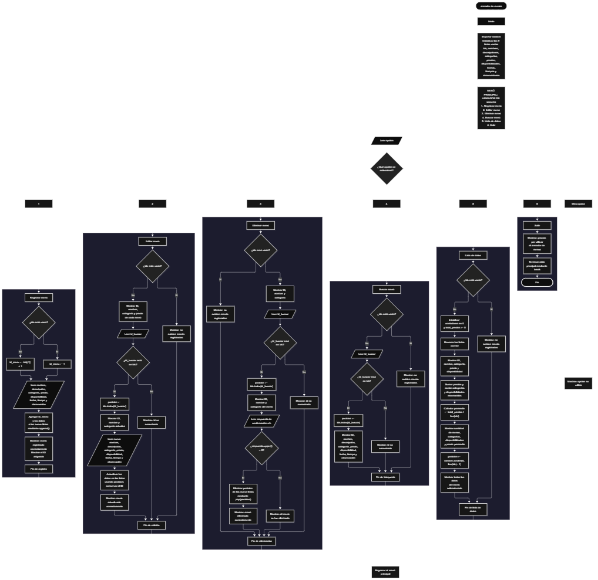

Este proyecto, llamado <b>armador de menús</b>, fue desarrollado en <b>python</b> como un ejercicio práctico para fortalecer la lógica de programación mediante la creación de un sistema de gestión de menús desde la consola. El programa cuenta con un menú principal de seis opciones que permite <b>registrar, editar, eliminar, buscar y listar menús, además de consultar sus datos completos</b>. Cada menú almacena información como el nombre del plato, la descripción, la categoría, el precio, la disponibilidad, la fecha de registro, el tiempo de preparación y las observaciones, utilizando nueve listas paralelas para mantener relacionados los datos de cada registro durante la ejecución. Durante su desarrollo se aplicaron conceptos fundamentales de programación, como variables, listas, estructuras condicionales, ciclos repetitivos, contadores, acumuladores y búsqueda de identificadores. También se implementaron estadísticas sobre las categorías y la disponibilidad, el cálculo del precio promedio y la selección aleatoria de un menú. Este proyecto permite poner en práctica los conocimientos adquiridos en Python y sirve como base para desarrollar sistemas de gestión más avanzados utilizando otros lenguajes y tecnologías.

<h2 align="center">⚙️ Funcionamiento del menú principal</h2>

### ➕ Registrar menú

La opción <b>1) registrar menú</b> permite registrar un nuevo plato en el sistema. Antes de realizar el registro, el programa comprueba si la lista <b>ids</b> está vacía mediante la condición <b>len(ids) == 0</b>. Si no existen menús registrados, asigna el identificador <b>1</b> a la variable <b>id_menu</b>. En caso contrario, genera el siguiente identificador sumando uno al último elemento de la lista mediante la expresión <b>ids[-1] + 1</b>. Después, solicita el <b>nombre, descripción, categoría, precio, disponibilidad, fecha de registro, tiempo de preparación y observación</b> del menú. El precio se convierte a un número decimal mediante <b>float()</b>, mientras que el tiempo de preparación se convierte a un número entero mediante <b>int()</b>. A continuación, utiliza el método <b>append()</b> para almacenar el identificador y los datos introducidos en sus respectivas listas. Finalmente, muestra el mensaje <b>"menú registrado correctamente."</b> y presenta el identificador asignado. El código solicita una categoría entre entrada, plato fuerte, bebida o postre, y una disponibilidad entre disponible o no disponible, pero no verifica que los valores introducidos correspondan a esas opciones.

### ✏️ Editar menú

La opción <b>2) editar menú</b> permite modificar la información de un menú registrado. Primero, el programa comprueba si existen registros mediante la condición <b>len(ids) == 0</b>. Si no hay menús almacenados, muestra el mensaje <b>"no existen menús registrados."</b>. En caso contrario, presenta una lista con el identificador, el nombre, la categoría y el precio de cada menú. Después, solicita el identificador que se desea editar y lo convierte a un número entero mediante <b>int()</b>. El programa comprueba si el identificador existe utilizando la condición <b>id_buscar in ids</b>. Si lo encuentra, obtiene la posición correspondiente mediante <b>ids.index(id_buscar)</b> y muestra parte de los datos actuales. A continuación, solicita el nuevo nombre, la descripción, la categoría, el precio, la disponibilidad, la fecha, el tiempo de preparación y la observación, actualizando los valores de las listas correspondientes a la misma posición. El identificador original permanece sin cambios. Finalmente, muestra el mensaje <b>"menú actualizado correctamente."</b>. Si el identificador no existe, presenta el mensaje <b>"id no encontrada."</b>.

### 🗑️ Eliminar menú

La opción <b>3) eliminar menú</b> permite eliminar un menú registrado mediante su identificador. Primero, el programa comprueba que existan registros. Si las listas están vacías, muestra el mensaje <b>"no existen menús registrados."</b>. Si hay menús disponibles, presenta una lista con el identificador, el nombre y la categoría de cada uno. Después, solicita el identificador que se desea eliminar y comprueba su existencia mediante <b>id_buscar in ids</b>. Si lo encuentra, utiliza <b>ids.index(id_buscar)</b> para obtener la posición del registro y muestra sus datos principales. A continuación, solicita confirmación mediante la pregunta <b>"¿desea eliminar este menú? (s/n): "</b>. Si la respuesta convertida a mayúsculas mediante <b>upper()</b> es igual a <b>"S"</b>, elimina la posición correspondiente de las nueve listas utilizando el método <b>pop(posicion)</b>. De esta manera, retira el identificador y todos los datos relacionados con el menú. Finalmente, muestra el mensaje <b>"menú eliminado correctamente."</b>. Si la respuesta no es <b>"S"</b>, presenta el mensaje <b>"el menú no fue eliminado."</b>. Si el identificador no existe, muestra el mensaje <b>"id no encontrada."</b>.

### 🔎 Buscar menú

La opción <b>4) buscar menú</b> permite localizar un menú mediante su identificador. Primero, el programa comprueba si existen menús registrados. Si no hay registros, muestra el mensaje <b>"no existen menús registrados."</b>. En caso contrario, solicita el identificador y lo convierte a un número entero mediante <b>int()</b>. Después, utiliza la condición <b>id_buscar in ids</b> para comprobar si el identificador está registrado. Si existe, obtiene su posición mediante <b>ids.index(id_buscar)</b> y muestra todos los datos del menú: <b>identificador, nombre, descripción, categoría, precio, disponibilidad, fecha, tiempo de preparación y observación</b>. El tiempo de preparación se muestra acompañado de la palabra <b>minutos</b>. Si el identificador no se encuentra en la lista, presenta el mensaje <b>"id no encontrada."</b>. Esta operación permite consultar la información completa de un menú sin necesidad de revisar todos los registros.

### 📋 Lista de datos

La opción <b>5) lista de datos</b> permite visualizar los menús registrados y consultar estadísticas generales. Primero, el programa comprueba si existen registros. Si la lista <b>ids</b> está vacía, muestra el mensaje <b>"no existen menús registrados."</b>. En caso contrario, inicializa los contadores <b>entradas, platos_fuertes, bebidas, postres, disponibles y no_disponibles</b>, junto con el acumulador <b>total_precios</b>, todos con el valor <b>0</b>. Después, utiliza un ciclo <b>for</b> para recorrer los registros y mostrar el identificador, el nombre, la categoría, el precio con dos decimales y la disponibilidad de cada menú. Durante el recorrido, suma los precios y utiliza estructuras condicionales para contabilizar las categorías y los estados de disponibilidad reconocidos. Posteriormente, calcula el precio promedio mediante la expresión <b>total_precios / len(ids)</b> y muestra la cantidad total de menús, los contadores por categoría, los estados de disponibilidad y el promedio de los precios con dos decimales. Finalmente, utiliza <b>random.randint(0, len(ids) - 1)</b> para seleccionar aleatoriamente una posición y mostrar todos los datos del menú correspondiente. Esta opción reúne el listado de los registros, el cálculo de estadísticas y la selección aleatoria de un menú.

### 🚪 Salir del menú principal

La opción <b>6) salir</b> permite finalizar la ejecución del programa. Cuando el usuario selecciona esta opción, el programa muestra el mensaje <b>"gracias por utilizar el armador de menus."</b> y ejecuta la instrucción <b>break</b>, que interrumpe el ciclo repetitivo <b>while True</b>. De esta manera, el usuario puede realizar las operaciones disponibles en el menú principal y finalizar el programa cuando lo desee seleccionando la opción correspondiente.

<h2 align="center">🧠 Temas aplicados en el proyecto</h2>

### 📦 Variables

En este proyecto se utilizan variables para almacenar temporalmente los datos de los menús, controlar la opción seleccionada, generar identificadores, localizar registros y calcular estadísticas. También se utilizan contadores para clasificar los menús según sus categorías y disponibilidad, además de un acumulador para sumar los precios y calcular el promedio. Cada variable cumple una función específica dentro de las operaciones del programa.

🔢 **Opcion:** Almacena la opción seleccionada por el usuario en el menú principal.

🆔 **Id_menu:** Almacena el identificador asignado al nuevo menú.

🔎 **Id_buscar:** Guarda el identificador introducido por el usuario para localizar un registro.

📍 **Posicion:** Almacena el índice del menú encontrado dentro de las listas.

📝 **Nombre, descripcion, categoria:** Almacenan los datos descriptivos del menú durante el registro.

💰 **Precio:** Almacena el precio del menú como un número decimal.

✅ **Disponibilidad:** Almacena el estado de disponibilidad introducido por el usuario.

📅 **Fecha, tiempo, observacion:** Representan la fecha de registro, el tiempo de preparación y las observaciones del menú.

📊 **Entradas, platos_fuertes, bebidas y postres:** Cuentan los menús de las categorías reconocidas.

🔄 **Disponibles y no_disponibles:** Cuentan los menús según los estados de disponibilidad reconocidos.

➕ **Total_precios:** Acumula los precios de los menús durante el recorrido.

📈 **Promedio:** Almacena el resultado de dividir el total de los precios entre la cantidad de menús registrados.

### 🗃️ Listas

En este proyecto se utilizan nueve listas relacionadas entre sí para almacenar los datos de cada menú. Todas las listas utilizan la misma posición para representar un registro. Por ejemplo, los datos del menú ubicado en la posición <b>0</b> se distribuyen entre <b>ids[0], nombres[0], descripciones[0], categorias[0], precios[0], disponibilidades[0], fechas[0], tiempos[0] y observaciones[0]</b>. Esta organización permite acceder a la información de cada menú durante las operaciones de registro, edición, eliminación, búsqueda y listado.

🆔 **Ids:** Almacena los identificadores de los menús registrados.

🍽️ **Nombres:** Almacena los nombres de los platos.

📝 **Descripciones:** Guarda las descripciones de los menús.

🏷️ **Categorias:** Almacena las categorías de los platos.

💰 **Precios:** Guarda los precios de los menús.

✅ **Disponibilidades:** Almacena los estados de disponibilidad.

📅 **Fechas:** Guarda las fechas de registro introducidas por el usuario.

⏱️ **Tiempos:** Almacena los tiempos de preparación en minutos.

📄 **Observaciones:** Contiene las observaciones adicionales de cada menú.

### 🔀 Estructuras condicionales

En este proyecto se utilizan las estructuras <b>if, elif y else</b> para controlar las operaciones del menú principal y comprobar las condiciones necesarias para gestionar los registros. Estas estructuras permiten verificar si existen menús almacenados, comprobar si un identificador se encuentra en la lista, decidir si se actualiza o elimina un registro y determinar si la respuesta de confirmación permite ejecutar una eliminación. También se utilizan para clasificar los menús por categoría y disponibilidad durante el cálculo de las estadísticas.

### 🔄 Estructuras repetitivas

En este proyecto se utilizan los ciclos <b>while</b> y <b>for</b>. El ciclo <b>while True</b> mantiene activo el menú principal y permite ejecutar las operaciones repetidamente hasta que el usuario selecciona la opción de salida. Los ciclos <b>for</b> recorren las listas para mostrar los menús registrados durante la edición, eliminación y consulta de datos. En la opción de estadísticas, el recorrido permite sumar los precios y contabilizar las categorías y los estados de disponibilidad. Estas estructuras facilitan el procesamiento de múltiples registros mediante un conjunto de instrucciones.

### 🎯 Estructuras de selección

El programa utiliza una estructura condicional compuesta por <b>if, elif y else</b> para seleccionar la operación que corresponde a la opción introducida por el usuario. Las alternativas permiten registrar, editar, eliminar y buscar menús, consultar la lista de datos o salir del programa. Si el valor introducido no coincide con ninguna de las opciones definidas, se ejecuta el bloque <b>else</b> y se muestra el mensaje <b>"opción no válida."</b>. Esta estructura organiza las operaciones disponibles dentro del menú principal.

### 🔄 Administración de registros

El programa utiliza las nueve listas paralelas para mantener organizada la información de los menús. Durante el registro, el método <b>append()</b> agrega los datos a sus respectivas listas. Durante la edición, se actualizan los valores de la posición encontrada. Durante la eliminación, el método <b>pop(posicion)</b> retira los datos correspondientes de todas las listas. Por último, las operaciones de búsqueda y consulta utilizan el identificador y su posición para recuperar la información del menú seleccionado. Este procedimiento permite mantener relacionados los datos de cada registro.

<h2 align="center">¿Cómo se implementaron las operaciones crud en el proyecto?</h2>

Las operaciones <b>crud</b> se implementaron mediante las opciones del menú principal. La operación <b>crear</b> corresponde a <b>registrar menú</b>, donde se introducen los datos de un nuevo plato; <b>leer</b> se realiza mediante las opciones <b>buscar menú y lista de datos</b>, que permiten consultar un registro específico o visualizar los menús registrados; <b>actualizar</b> corresponde a <b>editar menú</b>, donde se modifican los datos de un registro existente; y <b>eliminar</b> se realiza mediante <b>eliminar menú</b>, que solicita confirmación y retira los datos del registro seleccionado. Estas operaciones utilizan listas, identificadores, condicionales y ciclos para gestionar la información durante la ejecución del programa.

<h2 align="center">Diagrama de flujo del proyecto</h2>

<h2 align="center">🛡️ Validaciones del programa</h2>

### 📭 No existen menús registrados

Esta comprobación se utiliza en las opciones <b>editar menú, eliminar menú, buscar menú y lista de datos</b>. El programa verifica si la lista <b>ids</b> está vacía mediante la condición <b>len(ids) == 0</b>. Si no existen registros, muestra el mensaje <b>"no existen menús registrados."</b> y no continúa con la operación seleccionada. Esta comprobación también evita que el programa intente calcular el precio promedio o seleccionar una posición aleatoria cuando no hay menús almacenados.

### ❌ Identificador no encontrado

Esta comprobación se utiliza durante las operaciones de edición, eliminación y búsqueda. El programa verifica si el identificador introducido se encuentra en la lista <b>ids</b> mediante la condición <b>id_buscar in ids</b>. Si existe, obtiene su posición utilizando <b>ids.index(id_buscar)</b> y continúa con la operación correspondiente. Si no lo encuentra, muestra el mensaje <b>"id no encontrada."</b>. De esta manera, el programa distingue los identificadores registrados de aquellos que no corresponden a ningún menú almacenado.

### ⚠️ Confirmación de eliminación

Esta comprobación se realiza antes de eliminar un menú. El programa solicita una respuesta mediante la pregunta <b>"¿desea eliminar este menú? (s/n): "</b> y convierte el texto introducido a mayúsculas utilizando <b>upper()</b>. Si la respuesta es igual a <b>"S"</b>, elimina el registro de las nueve listas. Si la respuesta es diferente, muestra el mensaje <b>"el menú no fue eliminado."</b>. El código no comprueba expresamente que la respuesta sea únicamente <b>"S"</b> o <b>"N"</b>; cualquier otro valor también evita la eliminación.

### ⚠️ Opción no válida

El programa utiliza el bloque <b>else</b> del menú principal para mostrar el mensaje <b>"opción no válida."</b> cuando el usuario introduce una opción diferente de las seis alternativas disponibles. Después de mostrar el mensaje, el ciclo <b>while True</b> permite regresar al menú principal y continuar utilizando el programa.

<h2 align="center">🎯 Objetivo del proyecto</h2>

El objetivo principal de este proyecto es fortalecer la <b>lógica de programación</b> mediante el desarrollo de un sistema de gestión de menús en <b>python</b>. A través de su construcción se busca aplicar los conocimientos adquiridos sobre variables, listas, estructuras condicionales, ciclos repetitivos, búsqueda de identificadores, operaciones CRUD, contadores y acumuladores. Además, el proyecto permite comprender cómo registrar, consultar, modificar y eliminar información, calcular estadísticas y seleccionar registros aleatoriamente en una aplicación de consola. De esta manera, se establece una base para desarrollar sistemas de gestión más completos utilizando otros lenguajes y tecnologías.

